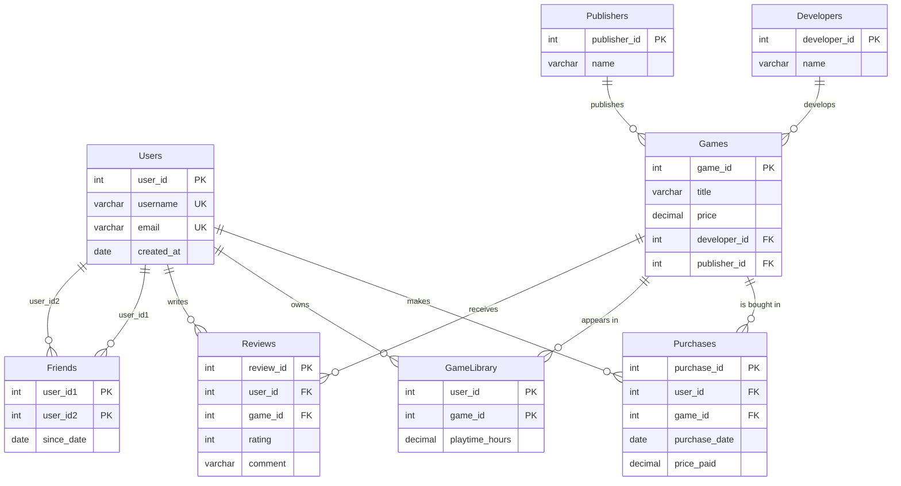

# Steam-Style Game Store Database

A relational database modeled after a digital game storefront (think Steam), written in **T-SQL for Microsoft SQL Server**. It covers users, games, purchases, personal libraries, reviews, and a friends network, and demonstrates core database concepts: views, functions, stored procedures, triggers, indexes, joins, subqueries, and set operations.

## Entity-Relationship Diagram

## Features Demonstrated

| Concept | Where |
|---|---|
| **View** | `vw_UserPurchasesDetails`: purchases joined with user and game info, plus the average game price |
| **Function** | `fn_TotalSpentByUser(@user_id)`: inline table-valued function returning a user's lifetime spend |
| **Stored procedures** | `sp_AddFriend` (order-independent, duplicate-safe) and `sp_GetGamesNotOwnedByUser` |
| **Trigger** | `trg_AddGameToLibrary`: inserting a purchase automatically adds the game to the buyer's library |
| **Index** | `idx_Purchases_User` on `Purchases(user_id)` |
| **Join** | Inside the view and the function (`JOIN` / `LEFT JOIN`) |
| **Non-correlated subquery** | Average game price in the view |
| **Set operation** | `EXCEPT` in `sp_GetGamesNotOwnedByUser` |
| **Constraints** | `PRIMARY KEY`, `FOREIGN KEY`, `UNIQUE`, `NOT NULL`, `CHECK`, `DEFAULT` |

## Design Notes

- **Friendships are stored once.** `sp_AddFriend` always writes the smaller user id first, so `(1,5)` and `(5,1)` are the same row, and a `CHECK` prevents befriending yourself.
- **Purchases vs. library.** `Purchases` is the transaction history (with `price_paid`, which can differ from the current list price); `GameLibrary` is what a user currently owns, with playtime. The trigger keeps them in sync.

## Getting Started

1. Create and select an empty database (e.g. `CREATE DATABASE SteamDB; USE SteamDB;`)
2. Run the scripts in order:

| Script | Purpose |
|---|---|
| `sql/01_schema.sql` | Drops and recreates all tables |
| `sql/02_seed_data.sql` | Loads sample data (30 users, 30 games, purchases, reviews, friendships) |
| `sql/03_database_objects.sql` | Creates the view, function, procedures, trigger, and index |
| `sql/04_demo_queries.sql` | Example queries that exercise every object |

The scripts are re-runnable: running them again resets the database.

## Notes

Sample data was generated with AI assistance. All names and emails are fictional.
